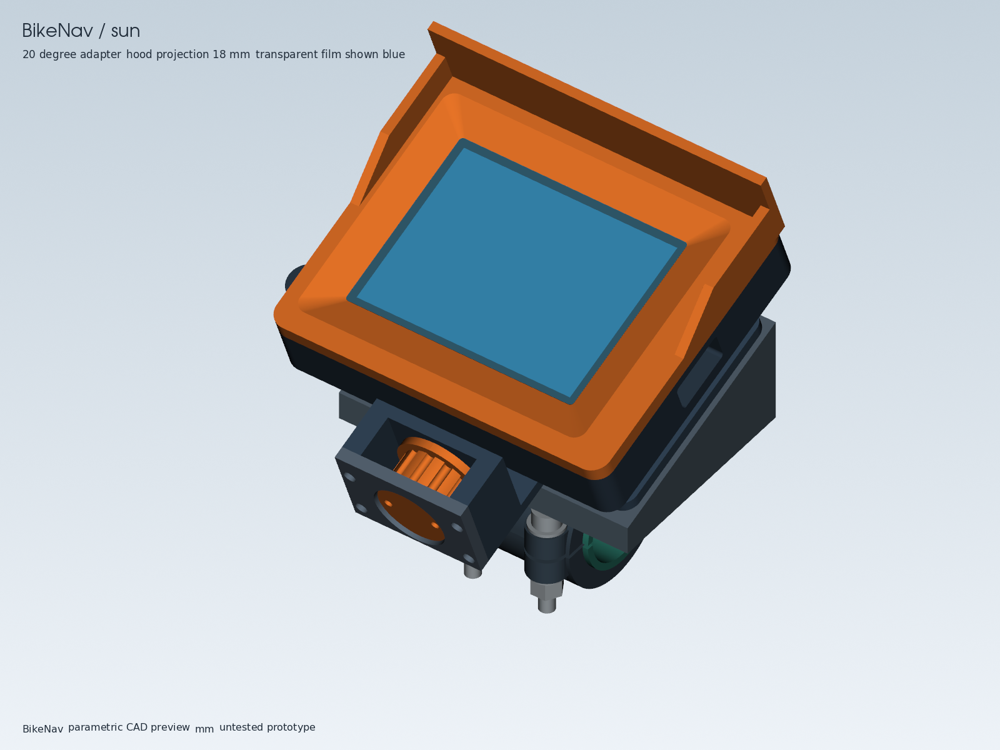
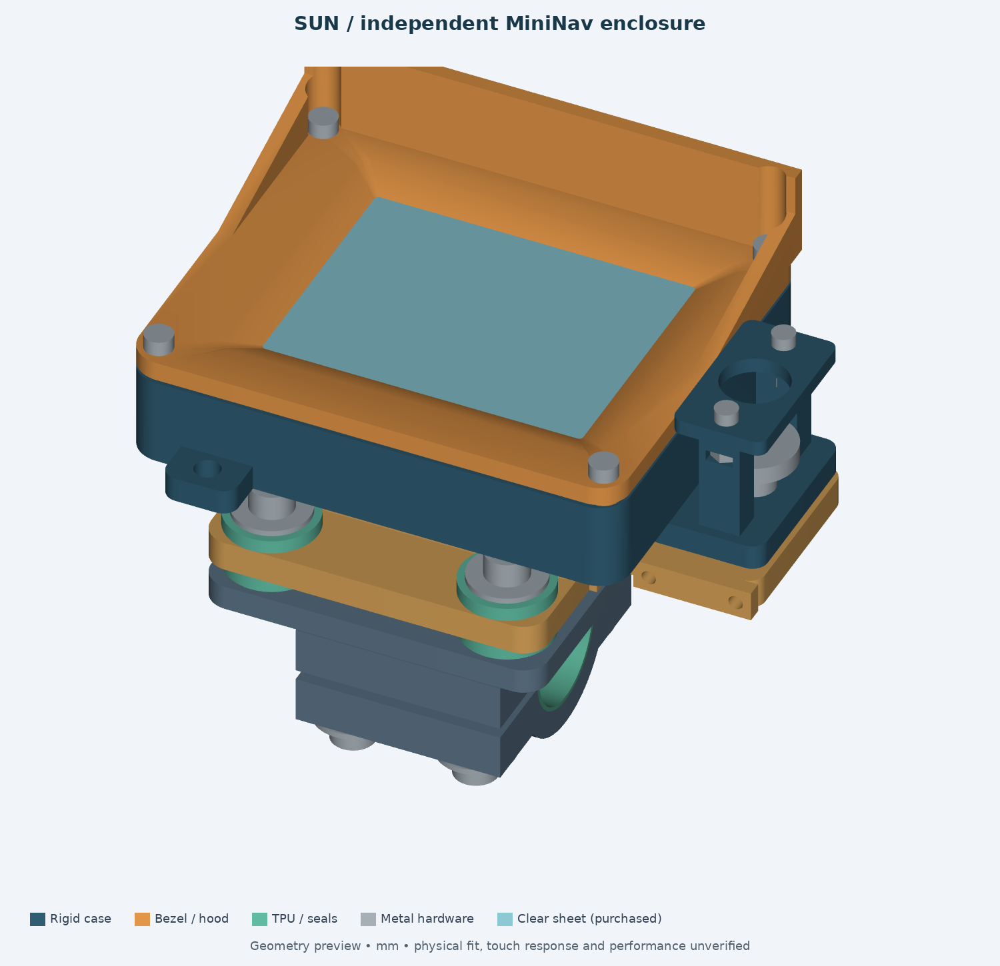

# MiniNav enclosure comparison — reviewed prototypes

**Print the `codex-work-models` fit coupons and a compact enclosure first.** It has the smaller face, shorter removal stroke, lower rigid material volume and thinner proposed window. The independent option is worth testing next if a removable screw-mounted board tray and a purchased thumbscrew are more valuable than size/material. Neither design is qualified for motorcycle use; physical fit, touch, sealing, temperature, retention and vibration tests remain outstanding.

| Original, reviewed | Independent, reviewed |
|---|---|
|  |  |
| [Start / build](codex-work-models/README.md) · [STLs](codex-work-models/stl/) · [Self-evaluation](codex-work-models/SELF-EVALUATION.md) | [Start / build](assistant-models/README.md) · [STLs](assistant-models/stl/) · [Self-evaluation](assistant-models/SELF-EVALUATION.md) |
| [Exploded](codex-work-models/previews/exploded_sun.png) · [Rear](codex-work-models/previews/rear_mount.png) · [Section](codex-work-models/previews/section.png) | [Exploded](assistant-models/previews/exploded.png) · [Rear](assistant-models/previews/assembly-rear.png) · [Bushing section](assistant-models/previews/bushing-detail.png) |

[Full side-by-side render sheet](previews/comparison.png) · [Variants and sections](previews/variants-and-sections.png). Images are rendered from actual CAD, inspected during review, and **not at a common scale**. Use the dimensions below for size comparisons.

## What was recovered

Both design sessions used the user-approved `codex-work` launcher with GPT-6 Astra and extra-high reasoning. Both ended at the work-account usage limit; the original scheduled review also failed before doing its work. These folder names identify design provenance, **not competing models or accounts**. Recovery completed and corrected both designs, so this is a comparison of reviewed prototypes rather than untouched original outputs. [Provenance, audit and reproduction](automation/README.md) · [pre-review artifact hashes](automation/recovery-baseline-sha256.json).

The original directory was renamed from `detachable` to `codex-work-models`; original upstream reference STLs remain byte-for-byte unchanged. Its reported `front_compact` failure came from a triangulation-inflated CAD bounding box: the STL's6 mm height was correct, while the manifest claimed8.988. Exact analytic bounds fixed the evidence without changing thresholds. Its old31/31 PASS report was stale and was replaced.

The independent gasket really intersected all four bezel hard seats (4.360665 mm³ total); paired seats/holes moved 0.5 mm outward. Review also corrected corner finger access, portrait mounting against landscape firmware, hood/head clearance, clamp washer seating and rotated nut geometry, the 1.1 mm washer stack, and stop screw engagement. It received the missing documentation/build/templates and expanded assembly checks. [Reproducible before/after evidence](automation/review-evidence.json) records the numeric diagnoses. All corrections are distinguished in the two self-evaluations.

## Same criteria, different tradeoffs

Dimensions below are nominal CAD/archived drawing values in mm; **bar diameter22.2 is an assumption in both**. CAD material volume is not slicer filament, printed mass, cost or strength. Sun assemblies are compared with the original's20° adapter.

| Criterion | `codex-work-models` | `assistant-models` | Interpretation / physical work |
|---|---|---|---|
| Face / glass height above bar |90×74;68.96 |96×78;67.50 |Independent face is larger; both sit roughly similar heights. Bike sightline/controls unknown. |
| Rigid CAD volume / printed pieces |163.41 cm³;20 including TPU gasket (19 with purchased silicone) |222.97 cm³;14 plus purchased seals |Original uses less rigid material; independent has fewer printed pieces. Hardware and fabrication complexity still matter. |
| Exported alternatives/coupons |22 STL files;6 coupons |23 STL files;7 coupons |Every file is a single valid closed solid; counts include choices, not one complete assembly quantity. |
| Electronics fit |451 conservative component boxes clear shell/front; compliant pads support factory pillars/glass perimeter |451 actual vendor solids checked against shell, bezel, tray, window; removable tray on assumed factory threads |Original needs carefully fitted pads; independent needs verified thread and blind depth. Both use2024 vendor evidence, not a scan of user's board. |
| USB / only open cavity penetration |16×8 opening;14×6 housing sweep to mouth;1.2695 seal web |16×9 opening;14×7 housing ends1.62 before mouth;1.6695 web |Actual cable overmold, nose, reach and service loop must be measured. Buttons/strap slots are closed in both. |
| Screen treatment |Purchased0.20 PET film,0.15 adhesive,0.15 glass gap |Purchased0.5 clear sheet,0.2 adhesive,0.2 glass gap |Original's thinner stack is a reason to test it first, not proof of better touch. Both require touch/glove/glare tests. |
| Hood and access |0/18/25 top;0/8/12 sides; flared aperture |0/18/22 top;0/10/12 sides; reviewed flare |16 mm fingertip proxies clear centres/corners. Human/glove usability and sun shading remain untested. |
| Sealing construction |Overlapping tongue;1.2→0.9 gasket in continuous groove;6 closure screws outside seal |Tongue/groove;1→0.7 purchased silicone ring;4 hard seats outside seal |Bond and compression continuity are geometrically plausible; USB opening, material porosity and actual compression preclude an IP claim. |
| Tool-free lock |Printed captive wheel, metal M4×35 bolt, external blind insert; positive head cover |Purchased DIN464 M4×16 screw captured on case; receiver nut behind screwed keeper |Both use positive threaded retention. Test hand access, insert/plastic-thread durability and repeat removal. |
| Slide removal |Single32 mm dovetail, disengages after36.35; reserve60 toward screen top |Dual52 mm T rails, disengage after59; reserve62 to screen right |Original needs less movement. Both need space for hands, hood, cable and actual bike obstructions. |
| Clamp / liner |32 rigid width + lips:35 straight bar;1 split gap;1→0.8 liner |40 straight bar;2 split gap;1→0.8 liner |Two-piece installation without removing controls. Neither matches an unmeasured aftermarket bar by default. |
| Screen angle |Replaceable0/20/30 adapters plus clamp rotation |Clamp rotation only, integrated base |Original offers separate angle adjustment; independent simplifies the rigid stack. |
| Compliant path |Four paired bushings,8 mm sleeves;56×36 pitch |Four one-piece grommets,11.4 sleeves; native62×46 pitch |Both isolate the floating carrier from fixed metal at rest; no claimed measured damping. |
| Stops / failure capture |Down1.5, up2.5, X onset1.5; Ø14 washer overlap2.5 |Down/radial1.0, up0.9; Ø15 washer overlap1.3 plus separate stop washers |These are nominal geometric contacts, not rated stroke or failure strength. Test coupled motion, TPU fatigue and tether capture. |
| Local thin sections |Floor2.5, tongue1.38, hood2.4, USB web1.2695 |Floor3, inner nut floor1.5, tongue1.6, hood2.8/relief1.3 |No global wall scan, slicer qualification, FEA or print proof. Inspect small webs and supports. |
| Variants |Compact/sun/deeper hood share rear and mount; touring cavity unchanged |Compact/sun/deeper touring cavity(+5) with matching tray/bezel, common mount |Independent better satisfies an optional deeper electronics variant; extra volume is not a battery certification. |

The common metrics can be regenerated with [review-geometry.py](automation/review-geometry.py). Detailed BOM, assembly sequence, orientations and adjustment contracts: [original](codex-work-models/ASSEMBLY.md) / [independent](assistant-models/ASSEMBLY.md), [original printing](codex-work-models/PRINTING.md) / [independent printing](assistant-models/PRINTING.md).

## Validation and limits

[Original generated report](codex-work-models/reports/VALIDATION.md) and [independent generated report](assistant-models/validation/VALIDATION.md) are authoritative for final counts. Their granularities differ: the original groups all 22 meshes in one check and checks three adapter assemblies; the independent reports CAD/STL checks separately and checks all three case variants. **A larger check count is not a higher score.** Both validate geometry, source/export consistency, mesh topology/volume/dimensions, vendor fit, seam/USB relationships, hardware, motion and nominal isolation gaps. Raw records are linked from each report.

All seven previews for each option were inspected, including regenerated flared fronts, revised independent landscape hood, exploded hardware, seam layout, rail lock, and isolation sections. Clear material is tinted for visibility; original assembly electronics are schematic, while the independent electronics render uses the vendor STEP. Installed TPU is a nominal compressed shape, not a deformation simulation. Common preview sheets omit no part from the underlying assembled views; section/case-removed views deliberately hide specified components.

No physical prints, measured fit on the user's bike/board, touch trials, sealed-body tests, sunlight/thermal trials, load tests, vibration/attenuation measurements, fatigue tests or road trials were performed. No load capacity, torque, safe speed, waterproof certification or measured vibration reduction is claimed. PLA is for initial fit work; later material choice remains subject to the actual environment and testing.

## Print and test order

1. Measure actual bar diameter/taper, straight length, steering/control clearance, board revision/supports and USB cable. Confirm screen orientation/sightline and detachment space on the bike.
2. Print the original rail/hole/USB coupons, a TPU pair and one compact enclosure. Purchase/test the 0.20 film and adhesive stack immediately; verify gentle pad restraint and touch corners/gestures before printing the full mount.
3. If those pass, print the measured clamp, chosen adapter, carrier and captive lock. Check compression sleeve seating, absence of rigid bypass, clamp grip, full release, positive capture and tether/cable slack on the bench. Add the18 mm sun hood after checking access and sightline.
4. For the independent alternative, first test the isolator coupon, real factory pillar screws and0.5 window touch stack. Its tray and purchased thumb screw may justify the larger shell if those interfaces work reliably.
5. With electronics removed, inspect seal witness marks and bonds. Progress through heat/creep, loosening, repeated removal, TPU set/fatigue and measured vibration trials before short tethered rides. Rework failures instead of treating CAD PASS as ride approval.

Publication uses a dedicated design branch based on `origin/main`, containing only these case deliverables. The existing research/helper branch and workspace remain intact; see the supervising assistant's final report for the actual commit and push outcome.
