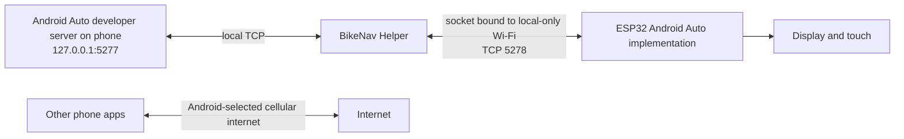

# Helper WiFi: problem, implementation and successful proof of concept

Recorded 2026-10-16. This is the development record for firmware **1.2.0-helper-alpha1** and Android helper **0.1.0-alpha1**. The [operator guide](helper-wifi.md) covers installation and testing; this document explains why this architecture was chosen, what was built, and what the evidence supports.

## Starting point and constraints

BikeNav uses a Waveshare ESP32-S3 2.8-inch display as an Android Auto head unit. The phone renders Android Auto and sends its video over TCP/Wi-Fi; the board handles Android Auto negotiation, TLS, decoding, display and touch. The initial device test used the `v1.1.1-bike` release on the user's recorded Pixel 8 Pro / Android 17 setup.

Requirements established during the investigation:

- Retain wireless Android Auto and the existing ESP32-S3 display hardware.
- Keep mobile internet usable on the phone during projection.
- Avoid running a phone hotspot for daily use: the user found its battery drain unacceptable.
- Support installation and diagnostics without requiring the user to set up ADB.
- Preserve the working connection modes as fallbacks while testing the new path.
- Do not treat reduced battery drain as established without measurements.

## First resolve the flashing issue

The first browser trace showed a working ROM connection, helper-stub upload and successful compressed flash-block acknowledgements. It also showed `FLASH_DEFL_BEGIN` (`0x10`) with a final offset field of `00100000`. Espressif's protocol encodes that word little-endian, making the upload address **0x1000**.

The release is a merged image containing bootloader, partitions and application and must start at **0x0**. The local image and the GitHub `v1.1.1-bike` asset had matching SHA-256 `4dfad8a0f5cd45542fee863a04ba5a3512603d8a70ae35a9f1eaef36575400b5`; replacing the release was not required to correct the address.

The user subsequently supplied a screenshot confirming **2,813,712 bytes written at 0x0**, matching file/flash MD5 hashes and a reset attempt. The user then reported the device worked, leaving internet coexistence as the remaining issue. This distinguishes successful flash verification from successful application operation; the screenshot alone did not prove the latter.

## Isolate the network problem

Two connection arrangements were compared:

| Arrangement | Android Auto | Phone internet | Evidence |
| --- | --- | --- | --- |
| Phone joins ESP32 Board WiFi | Working | User reports failure | User's device test |
| ESP32 joins Phone AP/hotspot | Working | Working | User explicitly confirmed both |

The firmware already omitted DHCP router and DNS advertisements and set its AP gateway to zero (`main/net.cpp`). Those measures did not fix the user's board-hosted Wi-Fi experience. They permit a useful local link but cannot dictate Android's default-network selection.

The Phone AP result showed the existing projection implementation could coexist with cellular internet on this phone. It did not prove the exact Android routing failure in Board WiFi mode: no `dumpsys connectivity`, routing dump or packet capture was available. The user could not use ADB at the time.

The user suggested comparing Insta360, whose app connects to a camera while preserving phone internet. REA tools were discovered, but device extraction was unavailable because ADB was absent and no APK was supplied. The user explicitly deferred reverse engineering. **No Insta360 binary was analyzed and no claim about its actual implementation was established.**

A Cloudflare/cloud tunnel was also considered. It would require an underlying internet path and would not fix the phone's local network selection. The useful version of the user's one-to-one connection idea was a phone-local relay with explicitly selected Wi-Fi sockets.

## Select the helper architecture

Android exposes `WifiNetworkSpecifier` for app-requested local-device Wi-Fi and `Network.bindSocket` for network-specific sockets. An ordinary helper can control its own sockets; it cannot simply rebind Android Auto's process or all other apps. Requesting Wi-Fi alone was therefore not treated as sufficient.

The implemented approach makes the helper own the Wi-Fi side of the Android Auto transport:

The helper forwards raw bytes. Android Auto TLS still runs between the existing headunit implementation and the phone server. No video decoding/re-encoding, cloud service or VPN was added.

At design time, phone-local access to the Android Auto server and the phone's cellular-selection behavior were hypotheses to test. The subsequent user proof of concept supplies functional evidence for this particular setup, not general compatibility across Android versions or manufacturers.

## Firmware changes

Implementation commit: `e09ef9d3b5531ed9fc41db2a7982738e0ceed27f`, on `fix/wifi-cellular-coexistence`.

- Added saved mode **3 / Helper WiFi**, following Board WiFi, Phone AP and Auto WiFi in the selector. Existing modes and saved preferences remain available; flashing does not automatically change the selected mode.
- Helper mode runs the board as an AP, with the existing one-phone WPA2 limit and DHCP router/DNS suppression.
- The Android Auto task listens on TCP **5278**, only in helper mode, rather than initiating the existing connection to the phone's port 5277.
- The accepted peer must match the current AP client's DHCP address and current endpoint generation. A disconnected/reassociated phone invalidates the stream.
- The helper sends an eight-byte preface, `BKNAVR1\n`. The firmware validates it incrementally with a five-second total deadline and preserves any following Android Auto bytes. The preface identifies the transport version; it is not an authentication secret.
- After acceptance, the existing Android Auto/TLS/video/touch session code operates on the accepted socket. The change does not replace Android Auto protocol negotiation.

Relevant files: `main/aap.cpp`, `main/helper_transport.h`, `main/net.cpp`, `main/app_main.cpp`, `main/app.h`, `main/board.cpp`.

## Android helper changes

The APK is a small native Java Android application with no third-party application library dependencies and no native ABI-specific libraries. Minimum Android API is 29; target/compile SDK is 35.

- The user starts the connection from the app and approves Android's local Wi-Fi dialog. The setup guide asks them to forget the manually saved MiniNav network first.
- Only the board socket is bound to the requested Wi-Fi network. The helper's entire process is not bound to Wi-Fi.
- The helper first connects to the board, then opens `127.0.0.1:5277`. It forwards bytes through bounded 32 KiB buffers in each direction.
- Closing either side or pressing Disconnect closes both sockets, including blocked reads/writes. The app avoids repeated automatic probes of the Android Auto server after a failed or ended session.
- A foreground `connectedDevice` service and a notification Disconnect action support operation outside the foreground Activity. A partial CPU wake lock is held while relaying, released on teardown and capped at six hours; no screen-on or high-performance Wi-Fi lock is requested.
- The UI reports default-network transport/validation, local Wi-Fi addresses/routes/DNS, byte counts, events and battery/temperature readings. These diagnostics describe observable state, not a guaranteed internet result for every other app.
- A Share debug report button exports a private-cache text file through a narrowly scoped read-only provider. The user chooses the recipient. No automatic upload, analytics, password logging or Android Auto payload capture occurs.
- The helper still requires the user to start Android Auto's developer headunit server. Its settings button is a convenience attempt, with a general Settings fallback; it is not server-start automation.

Relevant files are under `android-helper/app/src/main/java/com/kunstruct/bikenavhelper/`. `RelayPipe.java` contains the independently testable byte transport.

## Build, signing and release process

1. Built the firmware with the existing **ESP-IDF 5.4.2** environment. Generated the merged `docs/flash/MiniNav.bin` and its embedded browser-installer `.bin.js` using `tools/make_web_firmware.py`.
2. Provisioned build tools outside the repository: **JDK 17**, Android SDK Platform **35**, Build Tools **35.0.0**, Gradle **8.9**, Android Gradle Plugin **8.7.3**. Generated a standard Gradle wrapper and pinned its distribution SHA-256 after verifying the downloaded distribution.
3. Generated a persistent private release-signing keystore outside Git, under `~/.local/share/bikenav/signing/`, with restrictive filesystem permissions. Only environment variable names and the keystore alias are documented in the source. Updating the installed APK requires the same signing key; back up the signing material securely. No signing secrets are in the repository, release or Brain.
4. Assembled and linted the signed release APK and verified its APK signature. It is a release APK, not a debug APK. The operator needs no ADB or root to install it.
5. Verified the merged firmware contains the built application at **0x10000**, the expected version, and production rather than USB-test configuration. Decoded the browser image and checked exact binary equality, byte count and MD5.
6. Published prerelease **v1.2.0-helper-alpha1**, targeting the implementation commit rather than main. Assets: `MiniNav.bin`, `BikeNav-Helper-0.1.0-alpha1.apk`, `Helper-WiFi-Setup.md`, `BikeNav-SHA256SUMS.txt`.
7. Downloaded the published assets and verified the SHA-256 checksums. Later documentation-only success updates replaced the setup attachment and regenerated its checksum; APK and firmware stayed unchanged.

Binary SHA-256 identities for the published proof of concept:

| Asset | SHA-256 |
| --- | --- |
| `MiniNav.bin` | `a49223c4aed300f9c212a20d437f0cb0af264c66aef6ea59515c502b97fd3def` |
| `BikeNav-Helper-0.1.0-alpha1.apk` | `f8ae012ff8c334f5da357c4b8d6f2bce8ae707c4b46981910c21f374ee92defb` |

The [operator guide](helper-wifi.md#build-and-validation) has build commands. Generated APKs, build directories, local SDK configuration and signing files are ignored by Git. Firmware binaries are tracked because the local browser installer embeds them.

## Verification and limits of each result

| Check | Result | What it establishes |
| --- | --- | --- |
| Firmware production build | Passed | Source compiles/links for the target board |
| Android release assembly and lint | Passed; no lint issues | APK builds and static checks pass |
| APK signature verification | Passed | Installable signed artifact integrity, not device compatibility |
| Firmware host tests with ASan/UBSan | Passed | Existing parsers/geometry/socket/Wi-Fi policies plus partial/coalesced greetings, invalid prefaces, deadline and link loss |
| Java real-socket relay tests | Passed | Simultaneous binary transfer, fragmentation, counts, EOF, board disconnect and cancellation under backpressure |
| Firmware/browser-image consistency | Passed | Release packaging uses the intended production application |
| Published-asset checksums | Passed | Uploaded/downloaded artifacts match packaged files |
| User's phone/board proof of concept | Successful | User-reported functioning of the intended helper workflow on this setup |
| Battery comparison, extended screen-off operation, interruption recovery | Pending | No measured results supplied |
| Other phones/Android builds | Pending | No cross-device compatibility evidence |

No emulator or physical device was attached to the development environment for these checks. The user performed the functional device test independently.

## Successful proof of concept and remaining daily-use friction

On **2026-10-16**, after receiving the matched firmware/APK release, the user reported: **“The proof of concept works brilliantly.”** This was documented in commit `e11bf7e`, the release notes and Brain. In context, this confirms the intended functional workflow of Android Auto over board-hosted Wi-Fi alongside phone cellular internet without a phone hotspot. The confirmation did not include a diagnostic export, run duration or battery measurements.

The user then asked for thorough documentation, a PR to main, and a separate research branch focused on making daily use less cumbersome. The principal complaint is manually finding Android Auto's settings and starting the developer headunit server; the user reports Google hides that page until a device is connected.

The next investigation must distinguish:

- A reliable way to open settings, which saves navigation but leaves the server requirement.
- Starting the developer server through a supported or private Android entry point, including permissions and version compatibility.
- A real projection startup/transport that does not depend on the developer server, including any additional hardware requirements.
- Making helper lifecycle/reconnection more robust without repeatedly opening a server that can strand sessions.

Keep the successful proof of concept available while researching. Do not claim battery improvement from topology alone, or call a settings shortcut a replacement for the developer server. Research findings belong on a new branch created after the current PR is raised.

## Primary references

- [Espressif flashing protocol](https://docs.espressif.com/projects/esptool/en/latest/esp32/advanced-topics/serial-protocol.html): command fields and little-endian flash offset.
- [Android local-device Wi-Fi request API](https://developer.android.com/develop/connectivity/wifi/wifi-bootstrap): app-managed Wi-Fi connection requests.
- [Android Network API](https://developer.android.com/reference/android/net/Network): per-socket network binding.
- [Android connected-device foreground services](https://developer.android.com/develop/background-work/services/fgs/service-types#connected-device): service declarations and permissions.
- [Android Auto Desktop Head Unit testing](https://developer.android.com/training/cars/testing/dhu): developer headunit-server workflow.
- [Published BikeNav helper prerelease](https://github.com/kunstruct/BikeNav/releases/tag/v1.2.0-helper-alpha1): paired binaries and operator instructions.
